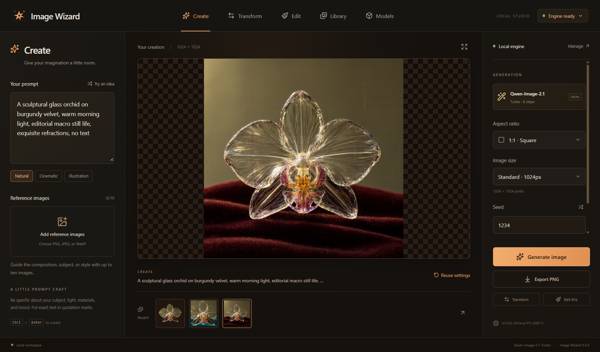

# Image Wizard

A Windows desktop image studio for **Qwen-Image-2.1-Turbo**. Midnight Atelier combines warm charcoal, copper accents, dedicated controls, and a large image canvas.



## Use the app

1. Launch `image-wizard.exe`, or run `npm run desktop` from a development checkout.
2. Open **Models**, review your hardware, choose the storage drive and memory profile, and read the Qwen Research License.
3. Choose **Install local engine**. The app downloads an isolated Python/CUDA runtime and the pinned official checkpoint. Progress remains visible across pages. Stop or restart to interrupt a transfer; **Resume setup** retains partial weights and verifies them before use.
4. Run **Check engine**. It makes a small text image and then edits that image. Generation becomes available only after both succeed with the selected profile.
5. Use **Create**, **Transform**, or **Edit**, choose output size and seed, and generate. Completed images enter **Library** automatically. **Export PNG** copies the original PNG to a new filename.

Setup needs internet access; inference uses local files with the Hugging Face loader offline. No API key or hosted subscription is required.

## Features

- Text generation, image-to-image transformation, and instruction editing with up to ten ordered references.
- Seven aspect ratios, draft/standard/native sizes, saved random or fixed seeds, prompt style helpers, and transparent-background requests.
- Original/reference comparison, expanded preview, recent images, searchable local library, and settings reuse.
- Hardware/storage detection, selectable model drive, isolated runtime, resumable downloads, checksum verification, repair, inference readiness checks, and cancellation.
- SQLite history plus PNGs and metadata journals. Inputs are separate PNG copies; edits create new images. Completed images are recovered if the app closes between file publication and history commit.
- An exclusive app-data lock prevents simultaneous instances from interrupting each other's work.
- Saved prompts, seeds, dimensions, precision, sources, parent image, model revision, runtime version, and KV-cache setting.

Engine-check images are retained as diagnostics in outputs and kept out of the creative library.

Editing uses Qwen's image-conditioned instruction pipeline and does not guarantee unchanged pixels outside an edit. There is no conventional denoise-strength slider or dedicated inpainting mask parameter. Turbo uses its official fixed eight-step sigma schedule. Transparency is requested from the model; actual alpha is inspected and preserved in PNG.

## Requirements

This release targets **Windows x64 with an NVIDIA CUDA GPU** and a current driver. WebView2 displays the desktop interface. The complete official checkpoint is approximately **32.5 GB**; allow at least **43 GB** initially for weights/runtime, plus outputs. Model files come directly from their pinned Hugging Face revision; all four weight files are SHA256 verified.

**Memory saver** quantizes the original encoder and transformer to NF4 at load time while retaining the official checkpoint on disk. **Original precision** uses BF16 with CPU model offload and needs substantial system RAM. Available sizes do not guarantee every size/reference count will fit. Each profile must pass its own engine check; start with Draft on a 16 GB GPU. Concurrent GPU applications, references, size, and precision affect memory use. Windows also needs sufficient virtual memory and free space for its paging file. Checkpoint loading uses Safetensors' byte-reading backend to avoid whole-file memory-map commit pressure.

The [official model](https://huggingface.co/Qwen/Qwen-Image-2.1-Turbo) uses the [Qwen Research License](https://github.com/QwenLM/Qwen-Image-2.1/blob/main/LICENSE): research/evaluation only, with a separate license required for commercial use. The app presents these terms; installation retains LICENSE and an attribution NOTICE. Weights are not included in this repository or executable.

## Local data

Default root: `%USERPROFILE%\.image-wizard`. Both backend data and the WebView profile live here, keeping standalone launches independent of packaged launchers' AppData redirection.

| Path | Contents |
| --- | --- |
| `studio.sqlite3` | Preferences, operation state, history (SQLite WAL) |
| `inputs/` | Imported reference copies |
| `outputs/` | Completed PNGs and metadata recovery journals |
| `operations/` | Exact worker requests |
| `runtime/` | Managed Python, dependencies, embedded worker/manifest |
| `logs/` | Per-operation diagnostics |
| `webview/` | Desktop UI profile and saved draft prompt |
| `models/` | Default snapshot; choose another drive in Models |

Changing storage selects a new snapshot location; it does not move an existing model. Export requires a new `.png` filename and preserves alpha. Back up these local files to retain your studio; there is no cloud synchronization.

## Development

Install Node.js/npm, Rust, Visual Studio C++ build tools, and WebView2. The app manages its own Python. Global Python is needed only for the downloader unit tests.

```powershell
npm ci
npm run desktop
```

Browser preview: `npm run dev`, then `http://127.0.0.1:1438`. Native installation, dialogs, and inference require the desktop executable.

```powershell
npm test
npm run build
python -m unittest discover -s engine -v
cargo fmt --manifest-path src-tauri/Cargo.toml -- --check
cargo clippy --manifest-path src-tauri/Cargo.toml --all-targets -- -D warnings
cargo test --manifest-path src-tauri/Cargo.toml
npm run desktop:build
```

Production output: `src-tauri/target/release/image-wizard.exe`, with frontend, worker, and manifest embedded. Runtime and weights are installed by the app. Packaging currently produces the executable, not an MSI/NSIS installer.

Pins: uv 0.11.32 (checksum verified), Python 3.12.12, PyTorch 2.9.1/CUDA 12.8 with Torchvision 0.24.1 ([official compatible versions](https://pytorch.org/get-started/previous-versions/)), Diffusers `1d5d056ecff3a8c1d887a7dd1aa66ca4a0323458`, Transformers 5.19.0, Accelerate 1.15.0, bitsandbytes 0.50.2, Safetensors 0.8.0, Pillow 12.3.0. Model revision: `d65dbc9a7e8f6b5479e33dee6030eaab2a906509`.

## Design and evidence

- [Product brief](docs/app-brief.md)
- [Verified model research and sources](docs/research/qwen-image-2.1-turbo.md)
- [Runtime implementation](docs/local-runtime-plan.md)
- [Checkpoint metadata](docs/research/model-manifest.json)
- [Selected design](docs/design/concepts.md)
- [Verification record](docs/verification.md)
- [Changelog](CHANGELOG.md)

The opening orchid is labelled illustrative artwork, generated with Codex imagegen. It is not evidence of Qwen output. Three Luna agents researched capabilities, runtime, and integration against primary sources before implementation.

Follow [AGENTS.md](AGENTS.md): update documentation and version history, then commit and push.
